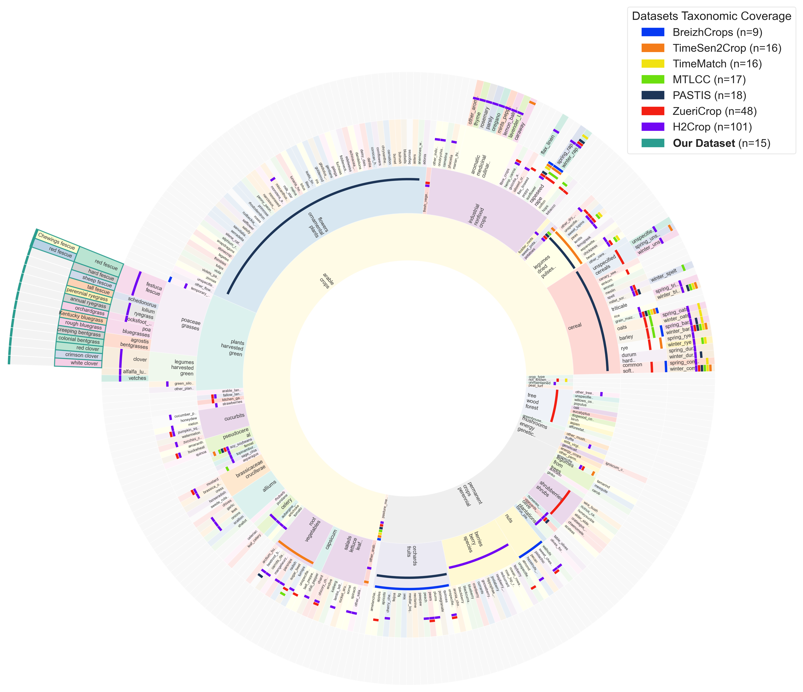
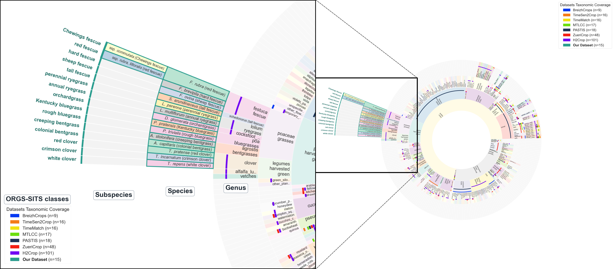
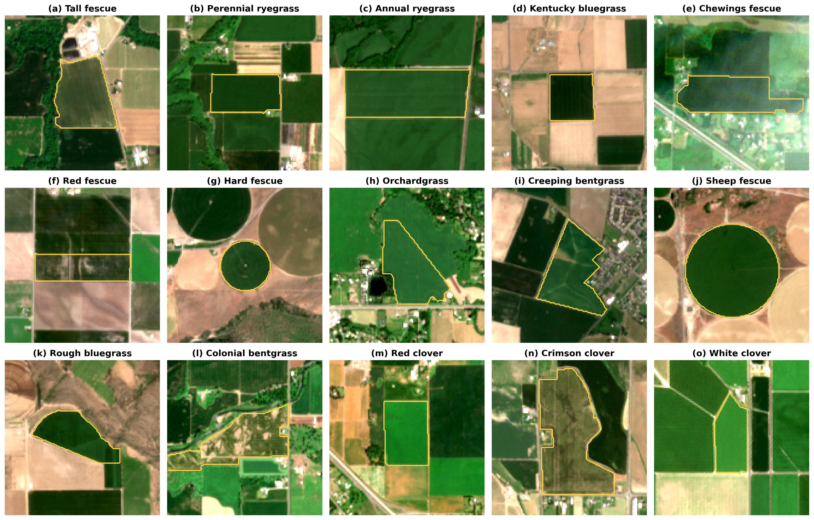

<div align="center">

# ORGS-SITS

### Species-Level Fine-Grained Crop Mapping Using Multispectral Satellite Image Time Series: A Feasibility Study in Grass Seed Crops

**Qianyi Duan**<sup>1,2</sup> · **Jing Zhou**<sup>1,\*</sup> · **Nicole P. Anderson**<sup>3</sup>

<sup>1</sup> Department of Crop and Soil Science, Oregon State University<br>
<sup>2</sup> School of Electrical Engineering and Computer Science, Oregon State University<br>
<sup>3</sup> Division of Food Production and Society, Norwegian Institute of Bioeconomy Research<br>
<sup>\*</sup> Corresponding author: [jing.zhou@oregonstate.edu](mailto:jing.zhou@oregonstate.edu)

[**🌐 Project Page**](https://qianyi-duan2023.github.io/ORGS-SITS/) &nbsp;|&nbsp;
**📄 Paper** (coming soon) &nbsp;|&nbsp;
**🗂️ Dataset** (coming soon) &nbsp;|&nbsp;
**💻 Code** (coming soon)

</div>

---

## 📰 News

- **[TBD]** Paper preprint released.
- **[TBD]** Dataset publicly released.
- **2025-08** Project page online.

## 🔍 Overview

**ORGS-SITS** (**OR**egon **G**rass **S**eed – **S**atellite **I**mage **T**ime **S**eries) is a benchmark dataset for **species-level fine-grained crop mapping** from
satellite image time series (SITS). It focuses on closely related **grass and legume seed
crop species** in Oregon, USA, and is designed to support the study of fine-grained crop
differentiation under high spectral, phenological, and taxonomic similarity.

- **Species-level labels** — goes beyond the finest level of existing crop taxonomies.
- **Fine-grained** — multiple closely related species within the same crop group
  (e.g., four fescues and two ryegrasses in the public release).
- **Multispectral time series** — Sentinel-2 imagery across the growing season.

<p align="center">
  
</p>
<p align="center"><sub>
<b>Dataset comparison under the HCATv3 framework.</b> Coloured markers show the category
coverage of public crop mapping datasets; the four rings represent increasingly fine HCAT
levels. ORGS-SITS extends beyond the outermost HCAT level to species-level labels.
</sub></p>

<p align="center">
  
</p>
<p align="center"><sub>
<b>Species-level category coverage of the proposed dataset.</b> The full fifteen-species
taxonomy of the original dataset, placed under HCATv3 agronomic categories. Tall fescue
(<i>Schedonorus arundinaceus</i>) is shown under the HCAT fescue category.
</sub></p>

## 🗂️ Dataset

> The dataset will be released upon publication of the paper. Download links and detailed
> documentation will be added here.

### Classes

The original dataset contains **15** grass and legume seed crop species. Because of the
sensitive and high-value nature of the underlying data, **9** species are included in the
public release:

| # | Species (common name) | Scientific name |
|---|---|---|
| 1 | Tall fescue | *Schedonorus arundinaceus* (Schreb.) Dumort. |
| 2 | Perennial ryegrass | *Lolium perenne* L. |
| 3 | Annual ryegrass | *Lolium multiflorum* Lam. |
| 4 | Kentucky bluegrass | *Poa pratensis* L. |
| 5 | Chewings fescue | *Festuca rubra* L. ssp. *commutata* Gaudin; syn. *F. rubra* L. ssp. *fallax* (Thuill.) Nyman |
| 6 | Red fescue ¹ | *Festuca rubra* L. ssp. *rubra* Gaudin; *F. rubra* L. ssp. *littoralis* (G. Mey.) Auquier |
| 7 | Hard fescue | *Festuca brevipila* Tracey |
| 8 | Orchardgrass | *Dactylis glomerata* L. |
| 9 | Creeping bentgrass | *Agrostis stolonifera* L. |

<sub>¹ Includes strong creeping red fescue (*F. rubra* ssp. *rubra*) and slender creeping red
fescue (*F. rubra* ssp. *littoralis*). In the figures, tall fescue is grouped with the
*Festuca* species under the HCATv3 "fescue" category, following agronomic convention.</sub>

<!-- TODO: add sample counts per class. -->

### Data format

<!-- TODO: fill in after release -->
| Item | Description |
|---|---|
| Sensor | Sentinel-2 L2A (multispectral) |
| Region | Willamette Valley, Oregon, USA |
| Time span | TBD |
| Samples | TBD (parcels / pixels) |
| Splits | TBD (train / val / test) |

```text
ORGS-SITS/            # planned layout
├── data/
├── labels/
└── splits/
```

<p align="center">
  
</p>
<p align="center"><sub><b>Representative Sentinel-2 imagery.</b> Red, crimson, and white clover (e, j, l) are not included in the public release.</sub></p>

## 📄 Paper

> **Species-Level Fine-Grained Crop Mapping Using Multispectral Satellite Image Time Series: A Feasibility Study in Grass Seed Crops**<br>
> Qianyi Duan, Jing Zhou, Nicole P. Anderson<br>
> *Manuscript in preparation.* A preprint link will be added here after release.

## 📌 Citation

If you find this dataset useful, please cite (BibTeX will be updated after publication):

```bibtex
@article{duan2025orgssits,
  title   = {Species-Level Fine-Grained Crop Mapping Using Multispectral Satellite Image Time Series: A Feasibility Study in Grass Seed Crops},
  author  = {Duan, Qianyi and Zhou, Jing and Anderson, Nicole P.},
  journal = {TBD},
  year    = {TBD}
}
```

## 📜 License

TBD.

## 📬 Contact

For questions, please open an issue or contact the corresponding author at
[jing.zhou@oregonstate.edu](mailto:jing.zhou@oregonstate.edu).
